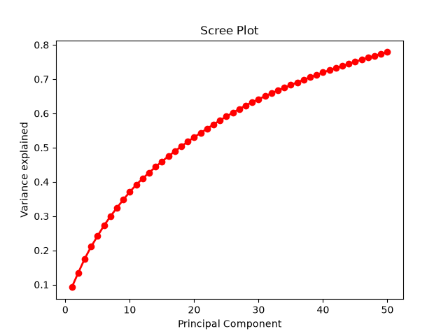

#+title: Experiment results

* Table of Contents :toc:
- [[#dataset][Dataset]]
- [[#handcrafted-features][Handcrafted features]]
  - [[#hog-features][HOG Features]]
  - [[#hog-features--image-pixels][HOG Features + Image pixels]]
- [[#exploratory-data-analysis][Exploratory Data Analysis]]

* Dataset
The dataset used for this experiment is Cifar10, consisting of 60000 32x32x3 images,
split into 50000 train, 10000 test.

The images contain 10 classes, respectively:
- airplane
- automobile
- bird
- cat
- deer
- dog
- frog
- horse
- ship

The classes are completely mutually exclusive. There is no overlap between automobiles and trucks.
"Automobile" includes sedans, SUVs, things of that sort.
"Truck" includes only big trucks. Neither includes pickup trucks.

* Handcrafted features

** HOG Features
For this set of runs I extracted from the original images after doing a
pre-processing step consisting of: Gaussian Blur + Resize to 32x32

| Classifier    | Classifier Specifications  | PCA Dimensions | Test Accuracy | Train Accuracy |
|---------------+----------------------------+----------------+---------------+----------------|
| Decision Tree | Max-Tree Depth = 5         |             50 |         0.233 |          0.281 |
| Random Forest | Leaf-size >= 15, 100 Trees |             50 |         0.246 |          0.970 |

#+CAPTION: Information preservation after PCA when reducing to 50 dimensions
#+NAME: fig:PCA-50d

After this very first run, on the train accuracy we can clearly see that the Decision Tree has been
underfitted completely, while the Random Forest might've been grown far too much.

| Classifier    | Classifier Specifications  | PCA Dimensions | Test Accuracy | Train Accuracy |
|---------------+----------------------------+----------------+---------------+----------------|
| Decision Tree | Max-Tree Depth =  10       |             50 |         0.234 |          0.388 |
| Random Forest | Leaf-size >= 25, 100 Trees |             50 |         0.241 |          0.869 |

Even after increasing the depth, not much has changed. It's a bit better than guessing randomly,
since tht would be 0.10.

| Classifier    | Classifier Specifications  | PCA Dimensions | Test Accuracy | Train Accuracy |
|---------------+----------------------------+----------------+---------------+----------------|
| Decision Tree | Max-Tree Depth =  15       |             50 |         0.198 |          0.751 |
| Random Forest | Leaf-size >= 30, 100 Trees |             50 |         0.257 |          0.815 |

Although training acc drops, suggesting it is not over-fitting anymore (RF), and the acc increased
suggesting not underfitting, the test accuracy does not move. So more likely a feature problem.

For this next set of runs, I have removed preprocessing altogether. Resizing to 32x32 does nothing,
Gaussian Blur does should just get in the way of HOG features, removing edges that are needed.

| Classifier    | Classifier Specifications  | PCA Dimensions | Test Accuracy | Train Accuracy |
|---------------+----------------------------+----------------+---------------+----------------|
| Decision Tree | Max-Tree Depth =  15       |             50 |         0.171 |          0.764 |
| Random Forest | Leaf-size >= 30, 100 Trees |             50 |         0.210 |          0.826 |

Unexpected, performed even worse => This is clearly a feature problem, not a configuration of
hyperparameters problem.

** HOG Features + Image pixels
| Classifier    | Classifier Specifications  | PCA Dimensions | Test Accuracy | Train Accuracy |
|---------------+----------------------------+----------------+---------------+----------------|
| Decision Tree | Max-Tree Depth =  15       |             50 |         0.225 |          0.733 |
| Random Forest | Leaf-size >= 30, 100 Trees |             50 |         0.324 |          0.825 |

This is a clear improvement on the test set compared to the baseline of just using HOG Features

| Classifier    | Classifier Specifications  | PCA Dimensions | Test Accuracy | Train Accuracy |
|---------------+----------------------------+----------------+---------------+----------------|
| Decision Tree | Max-Tree Depth =  15       |            100 |         0.206 |          0.733 |
| Random Forest | Leaf-size >= 30, 100 Trees |            100 |         0.300 |          0.876 |

* Exploratory Data Analysis
TODO: link absolutely every file after running data_analysis.py
But mostly it showed that color can be a very important, feature ( so theoretically )
first_color_moments should've represented a good split, but maybe it was not enough
information.
I have seen a paper that alongside HOG features it sent the RGB values of the
pixels, so I'll flatten and try that way.
